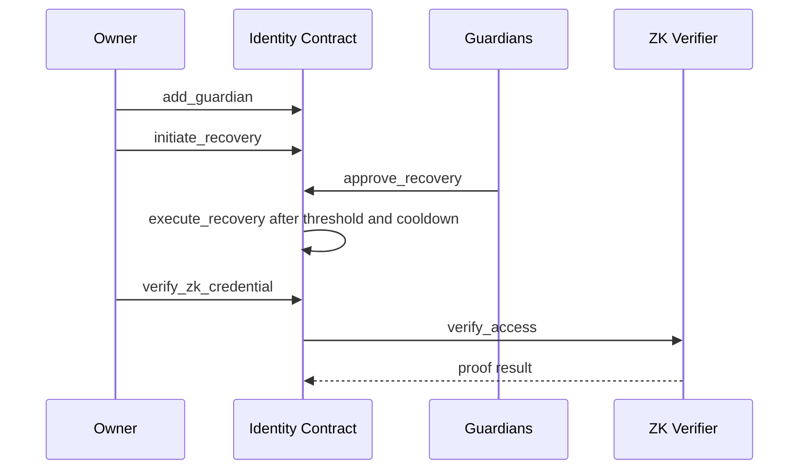

# Identity Contract API Reference

## Contract Purpose

Manages user identity recovery and social recovery mechanisms through guardian-based multi-signature approval. Enables secure identity ownership transfer and ZK credential verification without exposing sensitive credentials on-chain.

## Architecture at a Glance



## Initialization

### `initialize(env: Env, owner: Address) -> Result<(), RecoveryError>`

Initialize the identity contract with an owner address.

**Parameters:**

- `owner` - The initial identity owner and administrator

**Returns:** `Result<(), RecoveryError>`

**Errors:**

- `AlreadyInitialized` - Contract has been initialized before

**Example:**

```rust
client.initialize(&env, &owner_address)?;
```

---

## Public Functions

### Guardian Management

#### `add_guardian(env: Env, caller: Address, guardian: Address) -> Result<(), RecoveryError>`

Register a new guardian for social recovery (maximum 5 guardians per owner).

**Parameters:**

- `caller` - The identity owner (must authenticate)
- `guardian` - Address of guardian to add

**Returns:** `Result<(), RecoveryError>`

**Errors:**

- `Unauthorized` - Caller is not the active owner
- `GuardianLimitExceeded` - Already have 5 guardians

**Events:**

- `guardian_changed(caller, guardian, added=true)`

**Example:**

```rust
client.add_guardian(&env, &owner, &guardian_address)?;
```

---

#### `remove_guardian(env: Env, caller: Address, guardian: Address) -> Result<(), RecoveryError>`

Remove a guardian from the recovery list.

**Parameters:**

- `caller` - The identity owner (must authenticate)
- `guardian` - Address of guardian to remove

**Returns:** `Result<(), RecoveryError>`

**Errors:**

- `Unauthorized` - Caller is not the active owner

**Events:**

- `guardian_changed(caller, guardian, added=false)`

**Example:**

```rust
client.remove_guardian(&env, &owner, &guardian_address)?;
```

---

#### `get_guardians(env: Env, owner: Address) -> Vec<Address>`

Retrieve all guardians for an owner.

**Parameters:**

- `owner` - The identity owner's address

**Returns:** Vector of guardian addresses

**Example:**

```rust
let guardians = client.get_guardians(&env, &owner);
println!("Guardians: {:?}", guardians);
```

---

#### `is_guardian(env: Env, owner: Address, guardian: Address) -> bool`

Check if an address is a registered guardian for an owner.

**Parameters:**

- `owner` - The identity owner's address
- `guardian` - Address to check

**Returns:** `bool` — true if registered guardian

---

### Recovery Management

#### `set_recovery_threshold(env: Env, caller: Address, threshold: u32) -> Result<(), RecoveryError>`

Set the M-of-N approval threshold for recovery (M must be ≤ number of guardians).

**Parameters:**

- `caller` - The identity owner (must authenticate)
- `threshold` - Number of required approvals (1 to 5)

**Returns:** `Result<(), RecoveryError>`

**Errors:**

- `Unauthorized` - Caller is not the active owner
- `InvalidThreshold` - Threshold exceeds number of guardians

**Example:**

```rust
client.set_recovery_threshold(&env, &owner, 3)?;  // Require 3-of-5 approval
```

---

#### `initiate_recovery(env: Env, guardian: Address, owner: Address, new_address: Address) -> Result<(), RecoveryError>`

Guardian initiates recovery by proposing a new identity address.

**Parameters:**

- `guardian` - The guardian initiating recovery (must authenticate)
- `owner` - Current identity owner being recovered
- `new_address` - Proposed new identity address

**Returns:** `Result<(), RecoveryError>`

**Errors:**

- `Unauthorized` - Caller is not a registered guardian
- `RecoveryAlreadyActive` - Recovery request already in progress

**Events:**

- `recovery_initiated(owner, new_address, guardian)`

**Storage Update:**

- Creates new `RecoveryRequest` with initiating guardian's approval

**Example:**

```rust
client.initiate_recovery(&env, &guardian, &owner, &new_address)?;
```

---

#### `approve_recovery(env: Env, guardian: Address, owner: Address) -> Result<(), RecoveryError>`

Guardian votes to approve an active recovery request.

**Parameters:**

- `guardian` - The approving guardian (must authenticate)
- `owner` - The owner whose recovery is being approved

**Returns:** `Result<(), RecoveryError>`

**Errors:**

- `Unauthorized` - Caller is not a registered guardian
- `RecoveryNotFound` - No active recovery request for this owner
- `AlreadyApproved` - Guardian already approved this request

**Example:**

```rust
client.approve_recovery(&env, &guardian, &owner)?;
```

---

#### `execute_recovery(env: Env, caller: Address, owner: Address) -> Result<Address, RecoveryError>`

Execute recovery after cooldown period and sufficient approvals.

**Parameters:**

- `caller` - Address calling recovery (must authenticate)
- `owner` - The owner address being recovered

**Returns:** `Result<Address, RecoveryError>` — The new identity address

**Errors:**

- `RecoveryNotFound` - No active recovery request
- `CooldownNotExpired` - Must wait before executing
- `InsufficientApprovals` - Not enough guardian signatures
- `Unauthorized` - Caller not authorized

**Events:**

- `recovery_executed(owner, new_address)`

**Storage Update:**

- Transfers ownership to new address
- Deactivates old identity
- Clears recovery request

**Example:**

```rust
let new_address = client.execute_recovery(&env, &caller, &owner)?;
println!("Identity recovered to: {}", new_address);
```

---

#### `cancel_recovery(env: Env, caller: Address) -> Result<(), RecoveryError>`

Owner cancels an active recovery request.

**Parameters:**

- `caller` - The identity owner (must authenticate)

**Returns:** `Result<(), RecoveryError>`

**Errors:**

- `Unauthorized` - Caller is not the active owner
- `RecoveryNotFound` - No active recovery request

**Events:**

- `recovery_cancelled(caller)`

**Example:**

```rust
client.cancel_recovery(&env, &owner)?;
```

---

#### `get_recovery_request(env: Env, owner: Address) -> Option<RecoveryRequest>`

Retrieve the active recovery request for an owner.

**Parameters:**

- `owner` - The identity owner's address

**Returns:** `Option<RecoveryRequest>` — Details of active recovery or None

**Example:**

```rust
if let Some(req) = client.get_recovery_request(&env, &owner) {
    println!("Recovery in progress: {}", req.new_address);
}
```

---

#### `get_recovery_threshold(env: Env, owner: Address) -> u32`

Get the current recovery threshold for an owner.

**Parameters:**

- `owner` - The identity owner's address

**Returns:** M value from M-of-N scheme

---

### Ownership Status

#### `is_owner_active(env: Env, owner: Address) -> bool`

Check if an address is an active identity owner.

**Parameters:**

- `owner` - Address to check

**Returns:** `bool` — true if active owner

---

### DID Documents

A `did:retinax:*` identifier is created by its controller with `create_did`, then extended with verification keys and service endpoints. `resolve_did_document` assembles that on-chain state into a W3C DID Core-style document. The full field mapping is in [DID Resolution](../did-resolution.md).

#### `add_did_key(env: Env, owner: Address, did: String, key_id: String, key_type: DidKeyType, public_key: Bytes, purposes: u32) -> Result<(), RecoveryError>`

Register a verification key. The key's DID URL is `<did>#<key_id>`.

**Parameters:**

- `owner` - The DID controller (must authenticate and be an active owner)
- `did` - The DID to modify
- `key_id` - Fragment, 1-32 characters of `[A-Za-z0-9._-]`, unique across the DID's keys and services
- `key_type` - `Ed25519` (32 bytes), `X25519` (32 bytes) or `Secp256k1` (33-byte compressed key)
- `public_key` - Raw public key bytes
- `purposes` - Bitmask of `PURPOSE_AUTHENTICATION` (1), `PURPOSE_ASSERTION_METHOD` (2), `PURPOSE_KEY_AGREEMENT` (4), `PURPOSE_CAPABILITY_INVOCATION` (8), `PURPOSE_CAPABILITY_DELEGATION` (16). `X25519` keys must use exactly `PURPOSE_KEY_AGREEMENT`; signing keys must not use it.

**Errors:**

- `InvalidInput` - Bad fragment, key length, compressed-key prefix or purposes
- `AlreadyExists` - Fragment already used by a key or service on this DID
- `LimitExceeded` - The DID already has 10 keys
- `Unauthorized` - Caller is not the active owner or not the DID's controller
- `RecordNotFound` - DID does not exist
- `OwnerDeactivated` - DID is deactivated

**Events:** `("STREAM", "ID_DIDKY")` with `DidKeyChangedEvent { added: true }`

---

#### `remove_did_key(env: Env, owner: Address, did: String, key_id: String) -> Result<(), RecoveryError>`

Remove a verification key. Same authorization rules as `add_did_key`. Returns `RecordNotFound` if the key does not exist.

**Events:** `("STREAM", "ID_DIDKY")` with `DidKeyChangedEvent { added: false }`

---

#### `add_did_service(env: Env, owner: Address, did: String, service_id: String, service_type: String, endpoint: String) -> Result<(), RecoveryError>`

Register a service endpoint. The service's DID URL is `<did>#<service_id>`.

**Parameters:**

- `service_id` - Fragment, same rules as `key_id`
- `service_type` - 1-64 alphanumeric characters (e.g. `LinkedDomains`, `RetinaXRecords`)
- `endpoint` - 1-256 visible ASCII characters with a URI scheme (e.g. `https://...`, `did:...`)

**Errors:** as `add_did_key`; `LimitExceeded` at 10 services.

**Events:** `("STREAM", "ID_DIDSV")` with `DidServiceChangedEvent { added: true }`

---

#### `remove_did_service(env: Env, owner: Address, did: String, service_id: String) -> Result<(), RecoveryError>`

Remove a service endpoint. Returns `RecordNotFound` if the service does not exist.

**Events:** `("STREAM", "ID_DIDSV")` with `DidServiceChangedEvent { added: false }`

---

#### `get_did_keys(env: Env, did: String) -> Vec<DidKey>` / `get_did_services(env: Env, did: String) -> Vec<DidService>`

Raw stored keys and services, in insertion order.

---

#### `resolve_did_document(env: Env, did: String) -> Result<DidResolution, RecoveryError>`

Resolve a DID to a W3C-style `ResolvedDidDocument` plus `DidDocumentMetadata`. A deactivated DID resolves with `metadata.deactivated = true` and no verification methods, relationships or services.

**Errors:**

- `InvalidInput` - Not a `did:retinax:*` identifier, or longer than 128 bytes
- `RecordNotFound` - DID does not exist

**Example:**

```rust
let res = client.resolve_did_document(&String::from_str(&env, "did:retinax:patient-42"));
let auth_key_id = res.did_document.authentication.get(0); // "did:retinax:patient-42#key-1"
```

---

### ZK Credential Verification

#### `set_zk_verifier(env: Env, caller: Address, verifier_id: Address) -> Result<(), RecoveryError>`

Configure the ZK verifier contract for credential verification.

**Parameters:**

- `caller` - The identity owner (must authenticate)
- `verifier_id` - Address of deployed zk_verifier contract

**Returns:** `Result<(), RecoveryError>`

**Errors:**

- `Unauthorized` - Caller is not the active owner

---

#### `get_zk_verifier(env: Env) -> Option<Address>`

Retrieve the configured ZK verifier contract address.

**Returns:** `Option<Address>`

---

#### `verify_zk_credential(env: Env, user: Address, resource_id: BytesN<32>, proof_a: VkG1Point, proof_b: VkG2Point, proof_c: VkG1Point, public_inputs: Vec<BytesN<32>>) -> Result<bool, CredentialError>`

Verify a ZK credential proof via cross-contract call to zk_verifier.

**Parameters:**

- `user` - Address requesting verification (must authenticate)
- `resource_id` - Hash of resource being accessed
- `proof_a`, `proof_b`, `proof_c` - Groth16 proof points (BN254)
- `public_inputs` - Public inputs for proof verification

**Returns:** `Result<bool, CredentialError>` — true if credential valid

**Errors:**

- `Unauthorized` - ZK verifier not configured
- `CredentialInvalid` - Proof does not validate

**Events:**

- `zk_credential_verified(user, verified)`

**Cross-Contract Call:**
Delegates to configured `zk_verifier` contract

**Example:**

```rust
let verified = client.verify_zk_credential(
    &env,
    &user,
    &resource_id,
    &proof_a,
    &proof_b,
    &proof_c,
    &public_inputs
)?;
```

---

## Data Types

### Structs

#### `RecoveryRequest`

Represents an active, in-flight social recovery request for an identity owner.

```rust
#[contracttype]
#[derive(Clone, Debug)]
pub struct RecoveryRequest {
    /// Current owner address whose identity is being recovered.
    pub old_address: Address,
    /// Candidate new address proposed by guardians to receive ownership.
    pub new_address: Address,
    /// List of guardian addresses that have approved this recovery proposal.
    pub approvals: Vec<Address>,
    /// Ledger timestamp when recovery was initiated.
    pub initiated_at: u64,
    /// Ledger timestamp after which recovery can be executed (initiated_at + 172_800s / 48h cooldown).
    pub execute_after: u64,
}
```

| Field | Type | Description |
| :--- | :--- | :--- |
| `old_address` | `Address` | Current owner address undergoing social recovery. |
| `new_address` | `Address` | Proposed replacement address that will assume identity ownership upon execution. |
| `approvals` | `Vec<Address>` | List of unique guardian addresses that have voted to approve this recovery request. |
| `initiated_at` | `u64` | Ledger Unix timestamp (seconds) when the recovery proposal was created. |
| `execute_after` | `u64` | Ledger Unix timestamp (seconds) when the 48-hour cooldown period expires. |

---

#### `PrepareGuardianAddition`

Payload stored in temporary storage during the prepare phase of a two-phase commit (2PC) guardian addition transaction.

```rust
#[contracttype]
#[derive(Clone, Debug)]
pub struct PrepareGuardianAddition {
    /// The active identity owner requesting guardian addition.
    pub caller: Address,
    /// The candidate guardian address to be added.
    pub guardian: Address,
    /// Ledger timestamp when the prepare phase was executed.
    pub timestamp: u64,
}
```

| Field | Type | Description |
| :--- | :--- | :--- |
| `caller` | `Address` | The active identity owner initiating the 2PC operation. |
| `guardian` | `Address` | Address of the guardian to be added upon commit. |
| `timestamp` | `u64` | Ledger timestamp when the prepare phase was staged. |

---

#### `PrepareGuardianRemoval`

Payload stored in temporary storage during the prepare phase of a two-phase commit (2PC) guardian removal transaction.

```rust
#[contracttype]
#[derive(Clone, Debug)]
pub struct PrepareGuardianRemoval {
    /// The active identity owner requesting guardian removal.
    pub caller: Address,
    /// The guardian address to be removed.
    pub guardian: Address,
    /// Ledger timestamp when the prepare phase was executed.
    pub timestamp: u64,
}
```

| Field | Type | Description |
| :--- | :--- | :--- |
| `caller` | `Address` | The active identity owner initiating the 2PC operation. |
| `guardian` | `Address` | Address of the guardian to be removed upon commit. |
| `timestamp` | `u64` | Ledger timestamp when the prepare phase was staged. |

---

#### `PrepareThresholdChange`

Payload stored in temporary storage during the prepare phase of a two-phase commit (2PC) recovery threshold update transaction.

```rust
#[contracttype]
#[derive(Clone, Debug)]
pub struct PrepareThresholdChange {
    /// The active identity owner requesting threshold update.
    pub caller: Address,
    /// The proposed M-of-N threshold value (1 <= threshold <= guardian count).
    pub threshold: u32,
    /// Ledger timestamp when the prepare phase was executed.
    pub timestamp: u64,
}
```

| Field | Type | Description |
| :--- | :--- | :--- |
| `caller` | `Address` | The active identity owner initiating the 2PC operation. |
| `threshold` | `u32` | The new recovery approval threshold value. |
| `timestamp` | `u64` | Ledger timestamp when the prepare phase was staged. |

---

### Type Aliases

#### `VkG1Point`

```rust
pub type VkG1Point = Bytes;
```

Serialized representation of a BN254 elliptic curve G1 affine point ($64$ bytes: $32$ bytes X coordinate, $32$ bytes Y coordinate in big-endian byte order).

#### `VkG2Point`

```rust
pub type VkG2Point = Bytes;
```

Serialized representation of a BN254 elliptic curve G2 affine point ($128$ bytes: $64$ bytes X coordinate [$c_0, c_1$], $64$ bytes Y coordinate [$c_0, c_1$] in big-endian byte order).

---

### Event Data Types

All identity events are published under topic hierarchies compatible with the platform streaming event system (`STREAM`).

```rust
/// Fired when an identity owner status is changed (activated or deactivated).
#[contracttype]
#[derive(Clone, Debug, Eq, PartialEq)]
pub struct OwnerStatusChangedEvent {
    pub owner: Address,
    pub active: bool,
    pub timestamp: u64,
}

/// Fired when a guardian is added or removed.
#[contracttype]
#[derive(Clone, Debug, Eq, PartialEq)]
pub struct GuardianChangedEvent {
    pub owner: Address,
    pub guardian: Address,
    pub added: bool,
    pub timestamp: u64,
}

/// Fired when a recovery process is initiated.
#[contracttype]
#[derive(Clone, Debug, Eq, PartialEq)]
pub struct RecoveryInitiatedEvent {
    pub owner: Address,
    pub new_address: Address,
    pub initiated_by: Address,
    pub timestamp: u64,
}

/// Fired when a recovery process is executed successfully.
#[contracttype]
#[derive(Clone, Debug, Eq, PartialEq)]
pub struct RecoveryExecutedEvent {
    pub old_address: Address,
    pub new_address: Address,
    pub timestamp: u64,
}

/// Fired when a recovery process is cancelled.
#[contracttype]
#[derive(Clone, Debug, Eq, PartialEq)]
pub struct RecoveryCancelledEvent {
    pub owner: Address,
    pub timestamp: u64,
}

/// Fired when a ZK credential is verified.
#[contracttype]
#[derive(Clone, Debug, Eq, PartialEq)]
pub struct ZkCredentialVerifiedEvent {
    pub user: Address,
    pub verified: bool,
    pub timestamp: u64,
}
```

---

## Storage Layout & Key Conventions

The contract utilizes Soroban's tiered storage model (`Instance`, `Persistent`, `Temporary`):

| Key Format | Storage Tier | Value Type | TTL Policy | Purpose |
| :--- | :--- | :--- | :--- | :--- |
| `Symbol("ADMIN")` | Instance | `Address` | Contract instance lifetime | Initial owner/admin address set during `initialize`. |
| `Symbol("INIT")` | Instance | `bool` | Contract instance lifetime | Boolean initialization flag preventing double initialization. |
| `Symbol("ZK_VER")` | Instance | `Address` | Contract instance lifetime | Deployed `zk_verifier` contract address. |
| `(Symbol("OWN_ACT"), Address)` | Persistent | `bool` | Extended on write (Threshold: 5,184,000, ExtendTo: 10,368,000 ledgers) | Tracks whether an identity address is currently active. |
| `(Symbol("GUARD"), Address)` | Persistent | `Vec<Address>` | Extended on write | Ordered list of registered guardians for an identity owner (max 5). |
| `(Symbol("REC_THR"), Address)` | Persistent | `u32` | Extended on write | M-of-N threshold required to execute identity recovery. |
| `(Symbol("REC_REQ"), Address)` | Persistent | `RecoveryRequest` | Extended on write | Active in-flight recovery request for an identity owner. |
| `(Symbol("HLD_BIND"), Address)` | Persistent | `Vec<BytesN<32>>` | Persistent | List of 32-byte credential IDs bound to this identity DID. |
| `(Symbol("DID_DOC"), String)` / `(Symbol("DID_DOC"), Address)` | Persistent | `DidDocument` | Persistent | DID record, indexed by DID and by controller. |
| `(Symbol("DID_KEYS"), String)` | Persistent | `Vec<DidKey>` | Persistent | Verification keys for a DID (max 10). |
| `(Symbol("DID_SVCS"), String)` | Persistent | `Vec<DidService>` | Persistent | Service endpoints for a DID (max 10). |
| `(Symbol("DID_CRT"), String)` | Persistent | `u64` | Persistent | DID creation timestamp, reported as `metadata.created`. |
| `(Symbol("PREP_ADD_GUARD"), Address, Address)` | Temporary | `PrepareGuardianAddition` | Transaction lifetime | Staged 2PC state for adding a guardian. |
| `(Symbol("PREP_REM_GUARD"), Address, Address)` | Temporary | `PrepareGuardianRemoval` | Transaction lifetime | Staged 2PC state for removing a guardian. |
| `(Symbol("PREP_SET_THRESH"), Address)` | Temporary | `PrepareThresholdChange` | Transaction lifetime | Staged 2PC state for modifying recovery threshold. |

---

## Error Codes

### `RecoveryError`

Contract errors associated with identity initialization, social recovery, and guardian administration (`contracts/identity/src/recovery.rs`).

| Variant | Code | Description |
| :--- | :--- | :--- |
| `AlreadyInitialized` | `1` | Contract has already been initialized with an owner. |
| `NotInitialized` | `2` | Contract is not yet initialized. |
| `Unauthorized` | `3` | Caller lacks permissions, is not the active owner, or provided invalid 2PC context. |
| `MaxGuardiansReached` | `4` | Guardian limit exceeded (maximum 5 guardians allowed per identity). |
| `DuplicateGuardian` | `5` | Specified guardian is already in the owner's guardian list. |
| `GuardianNotFound` | `6` | Specified guardian is not present in the owner's guardian list. |
| `InvalidThreshold` | `7` | Threshold is invalid (must satisfy $1 \le \text{threshold} \le \text{guardian count}$). |
| `InsufficientGuardians`| `8` | Insufficient guardians registered to initiate recovery (minimum 3 guardians required). |
| `NotAGuardian` | `9` | Caller attempting recovery action is not a registered guardian for the owner. |
| `RecoveryAlreadyActive`| `10` | An active recovery proposal is already in progress for this owner. |
| `NoActiveRecovery` | `11` | No active recovery proposal found for this owner. |
| `AlreadyApproved` | `12` | Guardian has already submitted approval for the active recovery proposal. |
| `InsufficientApprovals`| `13` | Number of guardian approvals has not reached the required M-of-N threshold. |
| `CooldownNotExpired` | `14` | The 48-hour recovery cooldown period has not elapsed yet. |
| `OwnerDeactivated` | `15` | Target owner account has been deactivated following a completed recovery, or the DID is deactivated. |
| `InvalidInput` | `16` | A DID identifier, key, service or other DID document value is invalid. |
| `AlreadyExists` | `17` | The DID, or a key/service fragment within it, already exists. |
| `RecordNotFound` | `18` | The DID, key or service was not found. |
| `LimitExceeded` | `19` | The DID already has the maximum number of keys or services (10 each). |

---

### `CredentialError`

Contract errors associated with Zero-Knowledge (ZK) credential verification operations (`contracts/identity/src/credential.rs`).

| Variant | Code | Description |
| :--- | :--- | :--- |
| `Unauthorized` | `100` | Caller is not authorized to execute credential verification. |
| `VerifierNotSet` | `101` | The ZK verifier contract address has not been configured in contract storage. |
| `ZkVerificationFailed` | `102` | ZK SNARK proof verification failed, malformed proof buffer, or invalid public inputs. |
| `InvalidNonce` | `103` | Nonce provided is invalid or has already been consumed (replay prevention). |
| `CredentialExpired` | `104` | Credential expiration timestamp (`expires_at`) is earlier than current ledger time. |

---

## Events Reference

| Event Topic | Event Payload | Trigger |
| :--- | :--- | :--- |
| `("STREAM", "ID_STAT")` | `OwnerStatusChangedEvent` | Emitted when identity owner is activated upon initialization/recovery or deactivated. |
| `("STREAM", "ID_GUARD")` | `GuardianChangedEvent` | Emitted when a guardian is added (`added: true`) or removed (`added: false`). |
| `("STREAM", "ID_RINIT")` | `RecoveryInitiatedEvent` | Emitted when a guardian initiates a recovery proposal. |
| `("STREAM", "ID_REXEC")` | `RecoveryExecutedEvent` | Emitted when recovery is executed after cooldown and threshold approvals. |
| `("STREAM", "ID_RCNCL")` | `RecoveryCancelledEvent` | Emitted when the active owner cancels a pending recovery proposal. |
| `("STREAM", "ID_ZKCRD")` | `ZkCredentialVerifiedEvent` | Emitted when a ZK credential proof is verified via cross-contract call. |
| `("STREAM", "ID_DIDKY")` | `DidKeyChangedEvent` | Emitted when a DID verification key is added (`added: true`) or removed (`added: false`). |
| `("STREAM", "ID_DIDSV")` | `DidServiceChangedEvent` | Emitted when a DID service endpoint is added (`added: true`) or removed (`added: false`). |
| `("CRD_BIND", caller)` | `credential_id: BytesN<32>` | Emitted when an owner binds a credential ID to their identity DID. |
| `("CRD_UBND", caller)` | `credential_id: BytesN<32>` | Emitted when an owner unbinds a credential ID from their identity DID. |

---

## Related Documentation

- [DID Resolution](../did-resolution.md)
- [ZK Verifier Integration Guide](../ZK_INTEGRATION.md)
- [ZK Architecture](../zk-architecture.md)
- [Access Control Architecture](../access-control-architecture.md)
- [Emergency Protocol](../emergency-protocol.md)
- [Common Library Primitives](../common-library.md)
