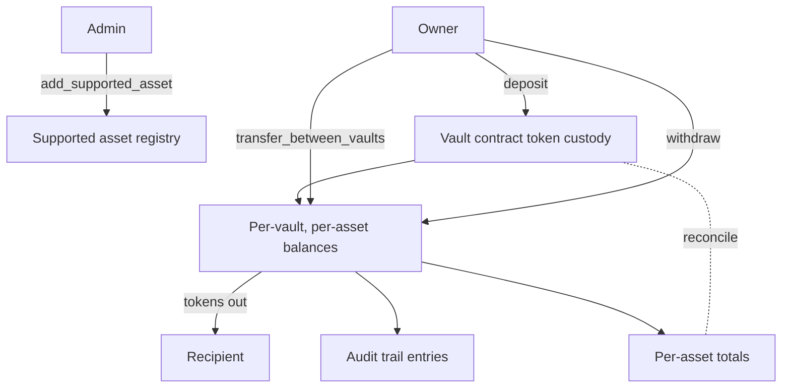

# Vault Contract API Reference

## Contract Purpose

Each identity owner gets a recovery vault, keyed by their address. The vault provides two things:

- **Key custody.** A secret seed is split with Shamir secret sharing across the owner's guardians from the identity contract. It can be rebuilt with a threshold of shares, through emergency guardian approval, or after a dead-man timeout.
- **Multi-asset accounting.** The vault holds any number of admin-approved Soroban tokens per owner. It tracks balances per asset, moves value between vaults without moving tokens, and keeps an audit trail of every balance change.

## Architecture at a Glance



## Initialization

### `initialize(env: Env, admin: Address, identity_contract: Address) -> Result<(), VaultError>`

Sets the admin, who manages the supported-asset registry, and the identity contract used to look up guardians. Can only be called once.

---

## Key Custody

| Function | Summary |
| --- | --- |
| `configure_vault(owner, threshold, shard_count, emergency_threshold, inactivity_timeout_secs, data_ref_hash, secret_seed) -> VaultSnapshot` | Creates the owner's vault and distributes shares to the first `shard_count` guardians. A vault must exist before it can hold assets. |
| `reconstruct_key(requester, owner, shares) -> BytesN<32>` | Rebuilds the secret from at least `threshold` valid shares. |
| `submit_emergency_approval(guardian, owner)` / `emergency_reconstruct(owner)` | Guardian-approved emergency recovery. |
| `rotate_key(owner, new_seed) -> RotationEvent` | Re-splits a new secret and bumps the epoch. |
| `touch_activity(owner)` / `trigger_deadman_release(owner)` | Dead-man switch. |
| `get_vault(owner) -> VaultRecord` | Vault configuration. |

---

## Multi-Asset Accounting

### Model

- **Assets** are Soroban token contracts, such as Stellar Asset Contracts, that the admin has approved. There can be at most 32.
- **Balances** are internal ledger entries keyed by `(owner, asset)`. The tokens themselves stay in the vault contract's custody.
- A **deposit** credits the amount the contract's token balance actually increased by, not the amount requested. A token that delivers less than requested therefore cannot inflate vault balances.
- A **transfer between vaults** changes two balances and moves no tokens.
- A **withdrawal** debits the balance first, then transfers tokens out (checks-effects-interactions).
- **Per-asset totals** (`get_total_balance`) always equal the sum of all vault balances in that asset. They should match `token.balance(vault_contract)`, so anyone can reconcile custody against them.
- The **audit trail** gets one immutable `LedgerEntry` for every balance change. A transfer writes an entry in both vaults.
- **Delisting** an asset blocks new deposits and transfers in it. Withdrawals keep working, so balances are never trapped.

### Admin

#### `add_supported_asset(env: Env, admin: Address, asset: Address) -> Result<(), VaultError>`

Approves a token. Adding an asset that is already approved does nothing.

**Errors:** `NotInitialized`, `Unauthorized` (caller is not the admin), `AssetLimitReached` (32 assets already approved)

**Events:** `("VLT_ASTA", asset)` with data `true`

#### `remove_supported_asset(env: Env, admin: Address, asset: Address) -> Result<(), VaultError>`

Delists a token. Removing an asset that is not approved does nothing.

**Errors:** `NotInitialized`, `Unauthorized`

**Events:** `("VLT_ASTA", asset)` with data `false`

#### `get_supported_assets(env: Env) -> Vec<Address>` / `is_supported_asset(env: Env, asset: Address) -> bool`

---

### Balance movements

All three return the resulting audit entry or entries. Each one emits `("VLT_ACC", owner, asset)` with data `(kind, amount, balance_after, seq)` for every entry it writes.

#### `deposit(env: Env, owner: Address, asset: Address, amount: i128) -> Result<LedgerEntry, VaultError>`

Transfers `amount` of `asset` from `owner` into custody and credits the owner's vault. Requires `owner` auth.

**Errors:**

- `VaultNotFound` - `owner` has no configured vault
- `UnsupportedAsset` - asset is not approved
- `InvalidAmount` - `amount <= 0` or the balance would overflow
- `DepositNotReceived` - custody balance did not increase

#### `withdraw(env: Env, owner: Address, asset: Address, amount: i128, to: Address) -> Result<LedgerEntry, VaultError>`

Debits the vault and sends `amount` tokens to `to`. Requires `owner` auth. Works for delisted assets.

**Errors:** `InvalidAmount`, `InsufficientBalance`

#### `transfer_between_vaults(env: Env, from: Address, to: Address, asset: Address, amount: i128) -> Result<TransferReceipt, VaultError>`

Moves balance from `from`'s vault to `to`'s vault. Requires `from` auth. Both vaults must be configured.

**Errors:** `SelfTransfer`, `InvalidAmount`, `VaultNotFound`, `UnsupportedAsset`, `InsufficientBalance`

---

### Queries

| Function | Returns |
| --- | --- |
| `get_balance(owner, asset) -> i128` | Vault balance in one asset (0 if none) |
| `get_balances(owner) -> Vec<AssetBalance>` | Every asset with a non-zero balance, in first-deposit order |
| `get_total_balance(asset) -> i128` | Sum of all vault balances in `asset` |
| `get_ledger_entry_count(owner) -> u64` | Number of audit entries |
| `get_ledger_entry(owner, seq) -> Option<LedgerEntry>` | One entry; `seq` starts at 1 |
| `get_ledger_entries(owner, start, limit) -> Vec<LedgerEntry>` | Up to `min(limit, 50)` entries from `start`, oldest first |

---

## Data Types

```rust
pub enum LedgerEntryKind { Deposit = 0, Withdrawal = 1, TransferIn = 2, TransferOut = 3 }

pub struct LedgerEntry {
    pub seq: u64,               // 1-based position in this vault's trail
    pub kind: LedgerEntryKind,
    pub asset: Address,
    pub amount: i128,           // always positive; direction comes from `kind`
    pub counterparty: Address,  // depositor / withdrawal recipient / other vault owner
    pub balance_after: i128,    // this vault's balance in `asset` after the entry
    pub timestamp: u64,
    pub ledger: u32,
}

pub struct AssetBalance { pub asset: Address, pub balance: i128 }

pub struct TransferReceipt {
    pub asset: Address,
    pub amount: i128,
    pub from_balance_after: i128,
    pub to_balance_after: i128,
    pub from_seq: u64,          // TransferOut entry in the sender's trail
    pub to_seq: u64,            // TransferIn entry in the recipient's trail
}
```

The trail can be replayed: starting from zero, add `Deposit` and `TransferIn` amounts and subtract `Withdrawal` and `TransferOut` amounts per asset, and every entry's `balance_after` is reproduced.

---

## Storage Layout

| Key | Tier | Type | Purpose |
| --- | --- | --- | --- |
| `ADMIN`, `IDENTITY`, `INIT` | Instance | `Address`, `Address`, `bool` | Configuration |
| `AST_REG` | Instance | `Vec<Address>` | Supported asset registry (max 32) |
| `(VAULT, owner)` | Persistent | `VaultRecord` | Vault configuration |
| `(SHARE, owner, epoch, guardian)` | Persistent | `VaultShare` | Guardian share |
| `(EM_APR, owner, guardian)` | Persistent | `bool` | Emergency approval |
| `(BAL, owner, asset)` | Persistent | `i128` | Balance; removed when it reaches zero |
| `(V_ASSETS, owner)` | Persistent | `Vec<Address>` | Assets with a non-zero balance |
| `(AST_TOT, asset)` | Persistent | `i128` | Sum of all vault balances |
| `(ACC_SEQ, owner)` | Persistent | `u64` | Audit trail length |
| `(ACC_LOG, owner, seq)` | Persistent | `LedgerEntry` | Audit trail entry |

Balance, asset-list and audit-trail entries extend their TTL on every write (threshold 5,184,000 ledgers, extended to 10,368,000).

---

## Error Codes (`VaultError`)

| Variant | Code | Description |
| --- | --- | --- |
| `NotInitialized` | 1 | Contract not initialized |
| `AlreadyInitialized` | 2 | `initialize` called twice |
| `Unauthorized` | 3 | Caller is not the admin, or not a guardian |
| `InvalidConfig` | 4 | Invalid vault threshold/shard configuration |
| `VaultNotFound` | 5 | Owner has no configured vault |
| `InsufficientShares` | 6 | Too few shares to reconstruct |
| `InvalidShare` | 7 | Share does not match the stored share |
| `EmergencyThresholdNotMet` | 8 | Not enough emergency approvals |
| `DeadmanNotReady` | 9 | Inactivity timeout has not elapsed |
| `UnsupportedAsset` | 10 | Asset not approved, or delisted |
| `InvalidAmount` | 11 | Non-positive amount or balance overflow |
| `InsufficientBalance` | 12 | Vault balance lower than the requested amount |
| `SelfTransfer` | 13 | Source and destination vault are the same |
| `AssetLimitReached` | 14 | Supported-asset registry is full |
| `DepositNotReceived` | 15 | Token transfer did not increase custody |

---

## Deployment Notes

- The identity contract has one active owner per deployment, so a single identity instance can only back one configured vault. Deployments where many owners need vaults, and so need vault-to-vault transfers, require an identity source whose `get_guardians` serves multiple owners.
- Approve only standard token contracts. Measuring the custody delta protects against tokens that deliver less than requested, but it cannot make a malicious token safe.
