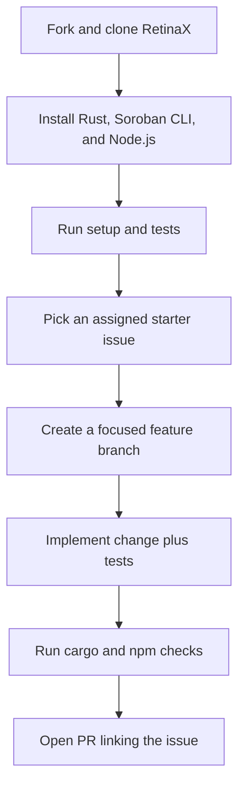

# Contributor Onboarding

This onboarding guide is a practical path from first clone to first merged PR.

## Start Here

- [Development environment setup](dev-environment.md)
- [Codebase tour](codebase-tour.md)
- [Good first issue selection guide](good-first-issues.md)
- [First contribution walkthrough](first-contribution.md)
- [Makefile command reference](makefile-reference.md)
- [Glossary](glossary.md)

## Prerequisites

- Rust 1.78+ (stable toolchain recommended; the offchain server may require a newer stable release)
- Soroban CLI compatible with the workspace `soroban-sdk`
- Node.js 20+ and npm for the website and documentation tests
- Git and Make
- Docker and Docker Compose only if you plan to run the offchain server locally

## Quick Start Checklist

1. Install Rust, the `wasm32-unknown-unknown` target, and the toolchain components.
2. Install a Soroban CLI version compatible with the workspace SDK.
3. Install Node.js 20+ and run `cd website && npm ci`.
4. Run `./setup.sh` or `make setup`.
5. Run `make test` and `cd website && npm test` to verify your environment.
6. Read the codebase tour and choose an issue with the [good first issue guide](good-first-issues.md).

## Visual Workflow

These diagrams replace the old static screenshots and render in current Chrome and Firefox on GitHub.
